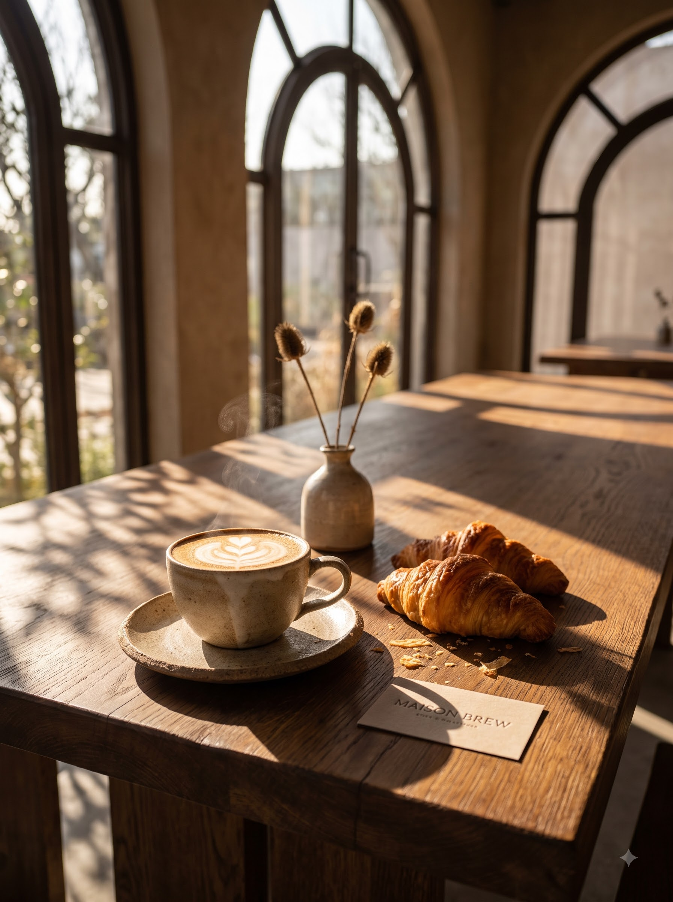

# Maison Brew: Terre & Crème ☕



**Maison Brew** is a production-ready, Awwwards-caliber web experience for a Luxury Specialty Coffee Roastery, Artisanal Viennoiserie & Architectural Sanctuary located in the Kala Ghoda Arts Precinct, Mumbai.

Built with a "Warm Organic Modernism" design DNA (Chestnut, Espresso, Vanilla Oat Foam, Buttermilk Crema), the application features complex micro-interactions, GSAP scroll animations, and global state management for an immersive user journey.

🌍 **Live Demo:** [maison-brew-app.vercel.app](https://maison-brew-app.vercel.app/)

---

## 🛠 Tech Stack

- **Framework**: Next.js 14 (App Router)
- **Library**: React 18
- **Styling**: Tailwind CSS
- **Animations**: GSAP (GreenSock) & ScrollTrigger
- **Smooth Scrolling**: Lenis (@studio-freight/lenis)
- **Icons**: Lucide React
- **Deployment**: Vercel

## ✨ Key Features

The application spans a 5-page Next.js architecture with rich, interconnected user flows:

- **The Flagship Monograph (`/`)**: Hero section, Craft Pillars, Roastery Collection, Interactive Cupping Dial, Atelier Preview, and immersive Footer.
- **The Complete Atelier Menu (`/menu`)**: A filtered culinary and specialty coffee menu featuring Viennoiserie, Sourdough Breads, Savory Hearth, Pour-Overs, and Signature Drinks.
- **The Origin Registry (`/terroir`)**: Deep-dive into Indian micro-lots from Chikmagalur and Araku Valley, complete with 1968 Probat flame roaster telemetry.
- **Architecture & Sanctuary (`/space`)**: A visual monograph of the Kala Ghoda pavilion, acoustic lime plaster, reclaimed teak, and courtyard garden.
- **Dedicated Booking Concierge (`/reserve`)**: A full-page, elevated reservation experience.

### 🔄 Interactive User Flows

1. **Table Reservation Ticket**: An end-to-end table booking form that generates a unique reservation code (e.g., `MB-2026-XXXX`) presented as an animated digital ticket.
2. **Shopping Cart Drawer**: A slide-over e-commerce drawer managing state for coffee pouch orders, subtotal calculations, and mock checkout.
3. **Sensory Dial Bridge**: An interactive coffee preference selector that bridges cross-component data directly to the reservation form as a "Special Request".
4. **Sanctuary Map Modal**: An immersive modal providing transit, valet, and geographic details for the Kala Ghoda location.
5. **Toast Notifications**: Animated confirmation popups for newsletter signups and cart additions.

---

## 🚀 Getting Started Locally

To run this project on your local machine:

**1. Clone the repository:**
```bash
git clone https://github.com/Jayant-1/maison-brew.git
cd maison-brew
```

**2. Install dependencies:**
```bash
npm install
```

**3. Run the development server:**
```bash
npm run dev
```

**4. View the app:**
Open [http://localhost:3000](http://localhost:3000) in your browser.

---

## 🎨 Design DNA & Assets

- **Typography**: `Inter Tight` (Primary Sans-Serif) & `Instrument Serif` (Italic Accents).
- **Color Palette**: Chestnut (`#864C31`), Espresso (`#222222`), Vanilla Oat Foam (`#FEF8DD`), Buttermilk Crema (`#F7EEC8`), Warm Linen Ivory (`#FAF7F2`), Golden Caramel (`#D4A055`).
- **Assets**: All imagery and videos are strictly referenced from `/public/assets` to maintain the highest quality visual fidelity.

---

*Designed and engineered with impeccable frontend taste by Google Antigravity.*
